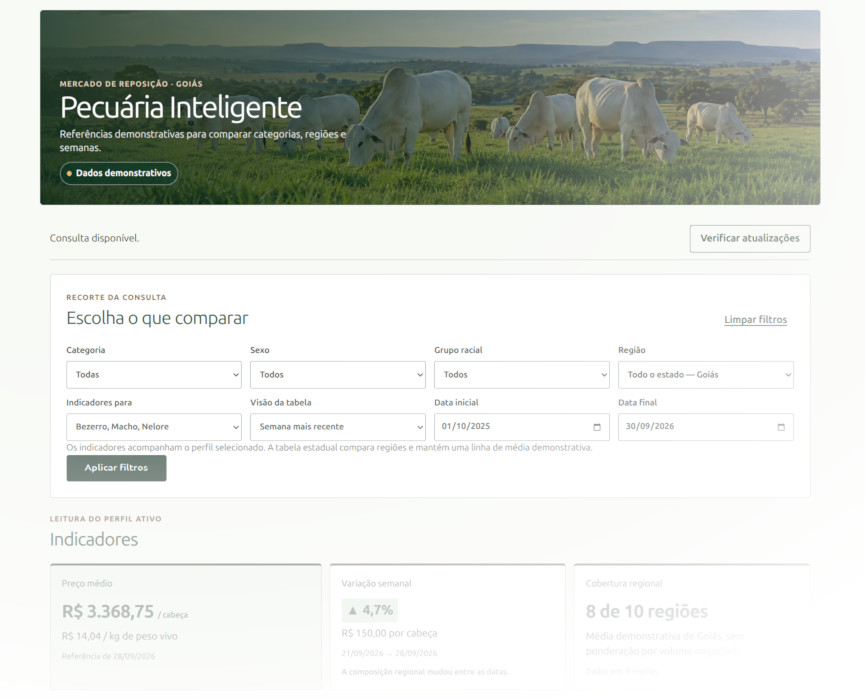

# Pecuária Inteligente

Central brasileira de inteligência de mercado para acompanhar preços e apoiar decisões na cadeia pecuária. A entrega acadêmica atual é um MVP de monitoramento de mercado para cria e recria em Goiás, com preços demonstrativos de bezerros e garrotes.



## Storytelling: como a IA acelerou este projeto

O projeto foi desenvolvido com apoio de IA no processo de engenharia de software. Esse apoio permitiu:

- transformar a proposta em requisitos verificáveis e critérios de aceitação;
- explorar alternativas de arquitetura e organizar planos de implementação;
- produzir incrementos pequenos com testes, documentação e revisão;
- investigar falhas e ampliar os cenários considerados.

O autor definiu o escopo, supervisionou as decisões, revisou os resultados e validou a entrega. A IA acelerou a exploração e a execução, mas não substituiu o julgamento humano, a validação das evidências ou a responsabilidade pela entrega. O contexto acadêmico e o registro do processo estão em [ABOUT.md](ABOUT.md) e [PROMPTS.md](PROMPTS.md).

O produto reúne contratos compartilhados, domínio de cálculos, API versionada e interface responsiva para filtrar perfis e períodos, visualizar preços, históricos, lacunas e indicadores. Os preços da v0.1 são fictícios e estão identificados como demonstrativos; não representam cotações reais nem substituem uma fonte comercial.

## O que está entregue

| Entregue na v0.1                                                  | Fora do escopo atual                        |
| ----------------------------------------------------------------- | ------------------------------------------- |
| Consulta de preços demonstrativos de bezerros e garrotes em Goiás | Cotações reais e atualização em tempo real  |
| Filtros por categoria, região e período                           | Gestão individual de animais e propriedades |
| Tabela, histórico, variações e indicadores                        | Cobertura de toda a cadeia pecuária         |
| API HTTP versionada e publicação demonstrativa no PostgreSQL      | Modelos preditivos incorporados ao produto  |
| Persistência local validada e painel responsivo                   | Favoritos, alertas e integrações externas   |
| Testes unitários, integração, segurança e E2E                     | Implantação pública de produção             |

O escopo e o roadmap completo estão em [Visão do produto e roadmap](docs/visao-produto-e-roadmap.md). A aceitação integrada da v0.1 está registrada em [docs/qualidade/v0.1-aceitacao.md](docs/qualidade/v0.1-aceitacao.md).

## Como usar no Linux

Pré-requisitos: Node.js `24.21.0`, npm `11.19.0` e, para integração/E2E, Docker Engine e Docker Compose. Na raiz do repositório:

```sh
make install
make data
make check
make test
make build
```

Para executar todas as verificações sem a infraestrutura completa:

```sh
make verify
```

Para subir a aplicação local com HTTPS, publicar a base demonstrativa e executar a aceitação do navegador:

```sh
make local-up
make local-publish
make e2e
make local-down
```

O fluxo completo, incluindo PostgreSQL, desempenho, E2E e segurança, está disponível em:

```sh
make acceptance
```

Os scripts npm continuam sendo a interface canônica e podem ser usados individualmente. Os atalhos GNU Make estão documentados em [Execução local](docs/execucao-local.md).

## Roteiro da banca

1. Executar `make local-up` e `make local-publish`.
2. Abrir `https://localhost` e aceitar a autoridade certificadora local conforme o guia.
3. Selecionar categoria, região e período; conferir a tabela, o histórico e os indicadores.
4. Verificar que os valores estão identificados como demonstrativos e que as lacunas não são tratadas como preço zero.
5. Executar `make test` e `make e2e`.

O roteiro detalhado, os resultados esperados, a limpeza do ambiente e as evidências para avaliação estão em [Guia de avaliação](docs/guia-de-avaliacao.md).

## Organização do repositório

- `packages/contracts/`: contratos, tipos, validação e serialização determinística.
- `packages/domain/`: filtros, calendário, cálculos decimais e apresentação.
- `apps/api/`: PostgreSQL, publicação demonstrativa e consultas HTTP versionadas.
- `apps/web/`: cliente progressivo, persistência IndexedDB e painel responsivo.
- `data/demonstrativa/v0.1/`: arquivos fixos, receita, cenários e hashes da base demonstrativa.
- `docs/`: guias de avaliação, operação, visão do produto e referências técnicas.
- `tools/quality/`, `compose*.yaml` e `infra/`: verificações, Docker Compose e HTTPS local.

Uma visão técnica dos módulos, dados e decisões está em [Arquitetura e implementação](docs/arquitetura-e-implementacao.md). O índice completo da documentação está em [docs/README.md](docs/README.md).

## Testes

O projeto utiliza TypeScript estrito, Vitest, React Testing Library, Playwright e PostgreSQL real nos testes de integração. Para uma verificação rápida:

```sh
make test
```

Para a aceitação do navegador em ambiente isolado:

```sh
make e2e
```

## Segurança

As verificações incluem `npm audit` e Semgrep. Credenciais locais são mantidas em arquivos ignorados e papéis independentes; a API, o PostgreSQL e a administração do Caddy não expõem portas públicas. O HTTPS local usa uma autoridade certificadora explícita, sem desativar a validação TLS ou modificar automaticamente a confiança do host.

Detalhes dos gates de segurança e da integração contínua estão em [Qualidade e limitações](docs/qualidade-e-limitacoes.md).

## Limitações identificadas

Os dados reais dependem de fontes disponíveis, históricas, compatíveis e autorizadas. A persistência local não oferece funcionamento offline completo. A matriz E2E cobre Chromium, Firefox e WebKit, mas não comprova todos os produtos comerciais, aparelhos físicos, metas de rede ou ocupação do IndexedDB em todos os navegadores.

Gestão individual de rebanhos, cotações reais, atualização em tempo real, modelos preditivos, favoritos, alertas e integrações externas permanecem planejados. As limitações técnicas completas estão em [Qualidade e limitações](docs/qualidade-e-limitacoes.md).

## Licença

O projeto foi desenvolvido no contexto da Especialização em Engenharia de Software: Automação e Inovação com Inteligência Artificial Generativa. Os termos de avaliação acadêmica estão em [LICENSE.txt](LICENSE.txt).
