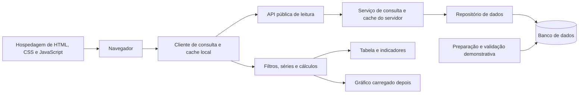

# Arquitetura da v0.1 — Pecuária Inteligente

Data: 04/10/2026.  
Aprovação: 05/10/2026.  
Estado: arquitetura aprovada após revisão. Os contratos e as políticas abaixo orientam a seleção de tecnologias e o plano de implementação; os limites operacionais serão validados por medição, conforme indicado em cada seção.

## Objetivo e decisões de base

Implementar a consulta pública demonstrativa de reposição em Goiás definida nos [requisitos da v0.1](2026-10-04-requisitos-v0.1-design.md), com oito perfis, dez regiões e histórico semanal de 12 meses. Priorizar a consulta textual em celulares com conexão lenta ou instável.

A interface será distribuída como arquivos estáticos, mas os preços virão de uma API que consulta um banco de dados. Atualizar os dados não exigirá recompilar ou publicar novamente a interface. O navegador não receberá credenciais nem acessará o banco diretamente.

Na v0.1, o banco conterá apenas dados demonstrativos. A futura importação de dados reais será uma operação separada, sujeita aos requisitos da v0.3. A arquitetura prepara essa substituição, sem implementar importação externa agora.

## Alternativas consideradas

| Alternativa | Primeiro acesso e atualização | Decisão |
| --- | --- | --- |
| Páginas com preços gerados na compilação | Consulta inicial pronta, mas alterações dos preços exigem nova geração. | Descartada pela preferência expressa do usuário. |
| Interface estática com dados via API | Estrutura leve; consulta depende da API no primeiro acesso. Dados mudam independentemente da interface. | Adotada, com carregamento progressivo e reutilização dos resultados. |
| Renderização no servidor com dados via banco/API | Pode entregar preços no HTML inicial; exige execução no servidor para gerar a página. | Alternativa futura se a medição mostrar que o primeiro acesso não atende aos limites. |

A geração estática se aplica à estrutura da interface. Não significa que os preços estejam embutidos nela. Sem JavaScript, a página deverá explicar que a consulta interativa precisa dele; o aviso demonstrativo e a descrição do produto permanecerão legíveis.

## Componentes e responsabilidades

- **Apresentação:** filtros acessíveis, avisos, tabela, indicadores e gráfico. Recebe um único estado de consulta; não calcula regras financeiras dentro dos componentes visuais.
- **Cliente de consulta:** solicita dados, valida respostas, controla atualizações, cancelamento e recuperação. Mantém versões e recortes disponíveis.
- **Domínio:** filtra registros compatíveis e calcula conversão, média, cobertura e variações. Não depende de rede, banco ou gráfico.
- **API e serviço de consulta:** validam parâmetros, leem uma versão consistente, devolvem metadados e controlam cache. Não calculam uma segunda versão dos indicadores da interface.
- **Repositório:** encapsula acesso ao banco, consultas parametrizadas e transações. Mantém a interface da API independente da tecnologia de armazenamento.
- **Preparação demonstrativa:** produz e valida os registros antes de publicá-los no banco. Não faz parte da consulta pública.

A interface e a API devem ser expostas preferencialmente pela mesma origem HTTPS, com `/api/` encaminhado ao serviço. O serviço e o banco terão implantação própria; uma hospedagem que só sirva arquivos não é suficiente para executar a API. Não haverá autenticação, escrita pública, conexão persistente nem atualização em tempo real na v0.1.

## Modelo de dados e publicação

Separar os cadastros de perfis e regiões dos registros semanais. Perfis contêm identificador estável, categoria, sexo, grupo racial, idade e peso de referência. Regiões contêm identificador, nome oficial, municípios e versão territorial. A composição municipal será documentada na preparação dos dados, com referência ao IMB.

Cada preço contém `perfilId`, `regiaoId`, `semana`, `preco`, `moeda`, `unidadePreco`, `natureza`, identificação do conjunto e condições comerciais. Valores monetários e pesos trafegam como cadeias decimais, sem símbolos ou separadores de milhar e com ponto como separador decimal. A moeda é obrigatória e identificada separadamente pelo código alfabético ISO 4217, como `BRL` ou `USD`; não é inferida do idioma, da região nem do símbolo exibido. Referência: [ISO 4217 — códigos de moedas](https://www.iso.org/iso-4217-currency-codes.html).

Na v0.1, os registros exigem `moeda: "BRL"` e `unidadePreco: "cabeca"`; o peso de referência do perfil usa `pesoReferencia` e `unidadePeso: "kg"`. Por exemplo, `preco: "3000.00"`, `moeda: "BRL"`, `unidadePreco: "cabeca"` e um perfil com `pesoReferencia: "200.00"`, `unidadePeso: "kg"` representam 3.000 reais por cabeça e 200 kg de peso vivo. A conversão para preço por kg de peso vivo produz um valor derivado com `unidadePreco: "kg_peso_vivo"` e preserva a moeda, sem substituir a observação por cabeça. O símbolo `R$`, a vírgula decimal e as unidades legíveis são aplicados somente na apresentação.

`unidadePreco` identifica a base da cotação, não inclui a moeda e usa um vocabulário controlado. Evitar `kg` e `arroba` sem qualificação, pois peso vivo e carcaça não são bases intercambiáveis.

| Valor proposto | Significado | Disponibilidade |
| --- | --- | --- |
| `cabeca` | Preço por animal. | Observações demonstrativas da v0.1. |
| `kg_peso_vivo` | Preço por quilograma de peso vivo. | Valor calculado na v0.1; observações nessa unidade exigirão evolução do contrato de entrada. |
| `kg_carcaca` | Preço por quilograma de carcaça. | Possível extensão para abate, fora da v0.1. |
| `arroba_carcaca` | Preço por arroba de carcaça. | Possível extensão para abate, fora da v0.1; documentar a massa correspondente à arroba. |
| `litro` | Preço por litro do produto identificado no registro. | Possível extensão para leite, fora da v0.1. |

As opções futuras são uma proposta de nomenclatura, não unidades já aceitas pela API da v0.1. Ao introduzi-las, definir produto, parâmetros de conversão e comparabilidade. Conversão entre peso vivo e carcaça exige rendimento explícito; não é apenas uma troca de unidade de massa.

Os cálculos usam aritmética decimal e arredondam somente para apresentação. A semana será representada por uma data civil `AAAA-MM-DD`, sem conversão para fuso horário do navegador.

Na integração futura de fontes reais, preservar a moeda e a unidade de origem de cada observação. Não somar, calcular médias ou variações nem comparar diretamente preços de moedas distintas. Conversão cambial fica fora da v0.1 e exigirá requisitos próprios para fonte, taxa, data de referência e método, preservando o valor original e identificando o valor convertido como derivado. A inclusão de moedas adicionais também exigirá revisar validação, identidade dos registros e contrato; o campo explícito não implica suporte multimoeda já implementado.

O banco deverá garantir unicidade de perfil, região e semana, referências válidas, valores positivos e publicação transacional. Ausência de preço será ausência de registro, nunca zero. Um conjunto demonstrativo não poderá misturar observações reais.

Uma versão publicada representa uma fotografia consistente dos cadastros e dos preços. Publicar alterações cria uma nova `versaoDados`, atualiza `publicadoEm` e invalida o cache do servidor após a confirmação da transação. O leitor vê a versão anterior completa ou a nova completa. Correções de semanas históricas também mudam a versão.

Registrar separadamente: data de referência do preço, momento de publicação dos dados, momento de recebimento no navegador e última verificação bem-sucedida. Uma verificação recente não torna recente a data de referência do preço.

Os instantes usam cadeias no formato RFC 3339, perfil de ISO 8601, normalizadas para UTC com três casas de milissegundos e sufixo `Z`: `AAAA-MM-DDTHH:mm:ss.SSSZ`. Exemplo: `2026-10-04T18:30:00.000Z`. Referência: [RFC 3339 — Date and Time on the Internet: Timestamps](https://www.rfc-editor.org/rfc/rfc3339.html).

| Campo | Origem e significado |
| --- | --- |
| `publicadoEm` | Gerado pelo servidor na publicação da versão dos dados e devolvido pela API. Não muda quando a mesma versão é consultada novamente. |
| `recebidoEm` | Gerado pelo navegador ao concluir o recebimento e a validação de uma resposta com dados. Guardado no cache da aplicação; não é um campo fornecido pela API. Ler dados salvos não altera esse instante. |
| `verificadoEm` | Gerado pelo navegador quando uma verificação da versão é concluída com sucesso, incluindo revalidação sem alteração de conteúdo. Falhas não atualizam esse instante; um `304` pode atualizá-lo sem alterar `recebidoEm`. |

Não aceitar instantes sem indicação de fuso nem usar textos localizados no contrato ou na persistência do cache. Na interface, formatar os instantes em português brasileiro no fuso `America/Sao_Paulo`, identificado como horário de Brasília. A data civil da semana permanece `AAAA-MM-DD`, sem horário nem conversão de fuso.

O relógio do navegador pode estar incorreto; `recebidoEm` e `verificadoEm` são registros locais, não evidências do horário do servidor. Não determinar a ordem das versões pela comparação desses instantes: usar `versaoDados` e o controle de requisições. Para esperas e atualização periódica durante a sessão, usar tempo decorrido monotônico; ao recuperar cache com horários locais futuros ou inválidos, considerar a verificação pendente e solicitar atualização, sem descartar preços válidos apenas por essa divergência.

## Contrato inicial da API

Contratos HTTP iniciais, independentes da linguagem e do banco. Formalizar o esquema e os exemplos na etapa de tecnologias e planejamento.

| Operação | Conteúdo e limites |
| --- | --- |
| `GET /api/v1/mercado/resumo` | Cadastros dos oito perfis e das dez regiões, metadados da janela e preços de todos os perfis/regiões na última semana da janela e na semana imediatamente anterior. Informar lacunas explicitamente. A lista completa de municípios não acompanha essa resposta. |
| `GET /api/v1/mercado/historico?perfilId=...&versaoDados=...` | Histórico de um perfil em todas as regiões, em toda a janela de 12 meses, incluindo a semana anterior ao início para RN07. A resposta identifica seu intervalo coberto, mesmo quando faltam registros. |

Ambas as respostas contêm `schemaVersion`, `versaoDados`, `publicadoEm`, `natureza`, condições comerciais e limites da janela. O histórico referencia os mesmos cadastros do resumo. A versão do contrato é distinta da versão dos dados.

O resumo disponibiliza o quadro mais recente de todos os perfis antes do histórico. Consulta inicial: “Todo o estado — Goiás”, todos os perfis na tabela mais recente e período completo de 12 meses. O perfil inicial do gráfico será Bezerro, Macho, Nelore, claramente indicado. A seleção do perfil do gráfico também seleciona seus indicadores; a tabela pode listar vários perfis sem calcular uma média entre eles. Filtros de categoria, sexo e grupo racial restringem os perfis elegíveis; o seletor de gráfico deve respeitar esse conjunto.

Após a consulta inicial, carregar primeiro o histórico do perfil ativo. Os demais históricos só são solicitados quando necessários ao recorte da tabela ou à seleção de outro perfil. Limitar a duas requisições simultâneas. Uma mudança para período histórico exige os históricos de todos os perfis elegíveis: só publicar a tabela desse novo recorte quando todos estiverem disponíveis na mesma versão. Não apresentar um resultado parcial como consulta completa.

No intervalo selecionado, a tabela estadual apresenta a última semana com preços de cada perfil, suas regiões e a média, identificando a data de cada perfil. Na consulta regional, utiliza a última semana com preço daquele perfil na região selecionada. O gráfico mostra a série completa do perfil ativo. Tabela e indicadores desse perfil usam as mesmas referências. Uma região sem registro na semana exibida na comparação estadual não é preenchida com preço de outra semana.

Parâmetros inválidos recebem `400`; perfil inexistente, `404`; versão solicitada já indisponível, `409` com código `VERSAO_INDISPONIVEL`; indisponibilidade temporária, `503`. Erros usam códigos e mensagens públicas, sem consultas de banco nem detalhes internos. Respostas de erro não são armazenadas em cache. Não há paginação arbitrária nem consulta sem limite temporal nessa versão.

O servidor pode manter versões anteriores por um prazo operacional, mas o cliente não depende disso: em `409`, busca um novo resumo e reconstrói a consulta. Mantém os resultados anteriores identificados até concluir a troca. Não mistura respostas de versões diferentes.

## Filtros, cálculos e coerência

Um estado central guarda filtros solicitados, filtros efetivamente exibidos, perfil ativo, versão e estado de carregamento. A interface distingue a consulta em andamento da última consulta concluída. Se uma troca falhar, mantém os resultados anteriores com indicação do recorte a que pertencem.

Mudanças de filtros sobre dados já completos são locais, sem requisição adicional. Requisições equivalentes em andamento são compartilhadas. Cada mudança recebe um identificador; respostas de consultas superadas não podem substituir a consulta atual.

Aplicar RN03–RN11 exatamente: média por perfil/semana, cobertura visível, peso de referência fixo, ausência excluída e comparação semanal somente com a semana imediatamente anterior. A referência anterior pode estar fora do intervalo exibido. A primeira e a última cotação disponível no período são usadas na variação do período, desde que sejam semanas distintas.

Na visão regional, a última cotação disponível dentro do período define a referência do perfil na tabela e nos indicadores. Na visão estadual, a última média disponível define essa referência. Datas diferentes entre perfis devem ser evidentes; não apresentar essas linhas como uma comparação da mesma semana. Nunca unir perfis em uma média, preencher lacunas do gráfico ou substituir a semana anterior por outra. Comparações estaduais mostram a cobertura de ambas as semanas e alertam para mudança de composição regional.

Limpar filtros restaura o estado inicial. Combinações sem perfis elegíveis ou sem registros produzem estado vazio, não uma consulta alternativa silenciosa.

## Cache e atualização automática

### Servidor e protocolo HTTP

O cache do serviço usa operação, parâmetros normalizados e versão como chave. Consultas simultâneas equivalentes reutilizam o mesmo carregamento. O resumo acompanha a versão atual do banco; uma nova publicação invalida sua entrada. Sem mudança, TTL interno máximo de 60 segundos como proteção adicional.

As respostas válidas usam `ETag` e `Cache-Control: public, max-age=60, must-revalidate`. Depois da validade, a revalidação condicional pode receber `304`, evitando transferir novamente o corpo. Falhas na revalidação não autorizam o cache HTTP a servir resposta vencida: a preservação dos resultados é responsabilidade explícita do estado da aplicação. Referência: [RFC 9111 — HTTP Caching](https://www.rfc-editor.org/rfc/rfc9111.html).

Recursos da interface com nomes versionados por conteúdo podem ter validade longa; o HTML deve ser revalidado. A escolha concreta de compressão, proxy e hospedagem será feita com as tecnologias.

### Navegador

Manter em memória os dados validados da sessão. Persistir, quando o armazenamento estiver disponível, o resumo e os históricos consultados, até os oito perfis da versão corrente, conforme o orçamento de armazenamento. Isso não implica carregar antecipadamente todos os históricos.

O limite de armazenamento persistente adotado é de 10.240 KiB (10 MiB), incluindo metadados e coexistência durante a troca. A [definição aprovada](2026-10-07-apresentacao-e-armazenamento-v0.1-design.md) registra a projeção completa, a estimativa no Chrome, a contabilidade lógica conservadora e a dispensa explícita de novas medições nos demais navegadores pelo autor. Bytes comprimidos transferidos pela rede não representam o espaço ocupado no armazenamento; o orçamento não garante quota física.

O orçamento será um limite configurável, não uma obrigação de ocupar toda a quota disponível no navegador. Ao atingi-lo, descartar primeiro históricos menos recentemente usados que não pertençam à consulta exibida. Proteger o resumo e os dados da consulta atual; remover versões anteriores somente depois de concluir a troca consistente descrita abaixo. Se o conjunto protegido não couber ou o navegador negar armazenamento, manter a consulta em memória, informar que não foi possível salvar seus dados para reutilização posterior e continuar sem persistir novos registros. Uma falha de armazenamento não pode apagar a última consulta salva válida nem bloquear a consulta em andamento.

Ao abrir, dados persistidos podem aparecer imediatamente como “Dados salvos — verificando atualização”, com datas visíveis. Sempre solicitar verificação do resumo. Sem dados salvos, apresentar estrutura e estado de carregamento, sem inventar preços.

Verificar o resumo a cada cinco minutos enquanto a página estiver visível e as verificações tiverem sucesso. Ao recuperar conexão ou retornar à página, verificar se a última verificação ocorreu há pelo menos 60 segundos. O botão de nova tentativa pode solicitar verificação imediata, respeitando a espera imposta por `Retry-After`. Não iniciar requisições periódicas em aba oculta nem acumular intervalos atrasados.

Usar um único coordenador para temporizador, retorno à aba, recuperação da conexão e tentativa manual, compartilhando a verificação em andamento. Priorizar consultas iniciadas pelo usuário sobre atualizações de fundo; estas não devem ocupar as vagas necessárias ao recorte solicitado. Quando o navegador sinalizar ausência de conexão, suspender novas tentativas automáticas até sinalizar recuperação ou o usuário solicitar uma tentativa. O sinal de conexão não garante acesso à API; falhas continuam sujeitas à política de recuperação.

Após esgotar as tentativas de uma verificação, aumentar o intervalo do próximo ciclo automático para 10, 20 e, depois, no máximo 30 minutos em falhas consecutivas, com variação aleatória de até 20%. Estes valores são propostas a medir, assim como o intervalo normal de cinco minutos. Sucesso restaura o intervalo normal. Recuperação de conexão pode antecipar uma verificação, mas nenhum gatilho contorna `Retry-After` nem inicia chamadas sobrepostas. A política de duas novas tentativas por requisição permanece distinta desse intervalo entre ciclos.

Se a versão não mudou, manter os históricos. Se mudou, preparar a nova versão separadamente, buscar os históricos necessários e substituir resultados, indicadores e gráfico juntos, somente após validação e completude. Manter a versão anterior exibida e salva durante toda a preparação; uma interrupção não pode removê-la nem misturar versões. No armazenamento persistente, confirmar a nova consulta por operação atômica ou mecanismo equivalente de confirmação antes de remover a anterior. Se faltar espaço para essa troca segura, conservar a consulta anterior salva e usar a nova em memória. A atualização não muda filtros nem posição de leitura.

Em falha, preservar resultados com “Não foi possível verificar atualizações”, datas e botão de nova tentativa. Informar quando a última verificação tiver mais de 15 minutos; esse prazo é um alerta operacional da proposta, não uma garantia de atualidade das cotações. Não apagar dados salvos apenas por idade, nem apresentá-los como atuais.

Não instalar um mecanismo de funcionamento offline completo na v0.1. Dados persistidos ajudam se a página carregar, mas reabrir a aplicação sem conexão não é garantido.

## Carregamento progressivo e recuperação

Carregar HTML, estilos e o cliente essencial; buscar o resumo; exibir tabela recente; obter o histórico ativo e calcular indicadores; só então carregar o módulo do gráfico. Os pontos históricos continuam consultáveis em tabela acessível, inclusive se o gráfico falhar.

Uma falha do gráfico oferece tentativa independente e não dispara nova busca de preços. Uma falha de histórico mantém o resumo disponível, identificando que o período solicitado ainda não carregou; não calcula uma variação de 12 meses com apenas duas semanas do resumo.

Prazo de cada requisição: 20 segundos. Fazer no máximo duas novas tentativas automáticas para falha de rede, `429` ou `503`, com espera inicial de 2 e 5 segundos e variação aleatória de até 20%. Com `Retry-After`, aguardar pelo menos o prazo informado e o atraso local previsto; o valor pode ser segundos ou uma data HTTP. Esperas maiores que 60 segundos suspendem a tentativa automática e informam indisponibilidade. Não repetir automaticamente erro de validação ou de contrato. Sucesso reinicia a contagem; o ciclo periódico não pode gerar tentativas sobrepostas.

## Orçamento de desempenho proposto

Estes limites foram aprovados como orçamento inicial e serão verificados por medição na implementação. Considerar primeiro acesso sem cache, janela completa e oito perfis, incluindo lacunas demonstrativas. Ajustes deverão ser justificados pelas medições e registrados na arquitetura.

| Condição | Limite proposto |
| --- | --- |
| Rede simulada | 400 kbit/s de download, 200 kbit/s de upload e latência de ida e volta de 800 ms. |
| Aparelho de referência | Tela de 440 × 956 pixels na orientação vertical e 956 × 440 pixels na horizontal, navegador com redução de CPU de 4 vezes; registrar máquina, navegador e versões para reprodução. Complementar futuramente com aparelho real. |
| Interface essencial | Até 100 KiB transferidos comprimidos, somando HTML, CSS e JavaScript antes do gráfico; sem fontes externas obrigatórias. |
| Resumo | Até 40 KiB transferidos comprimidos. |
| Histórico de um perfil | Até 100 KiB transferidos comprimidos. |
| Gráfico | Até 60 KiB adicionais transferidos comprimidos. |
| Primeiros preços utilizáveis | Até 10 segundos desde a navegação, sem cache e com API disponível. |
| Histórico ativo e indicadores completos | Até 15 segundos desde a navegação nas mesmas condições; gráfico até 18 segundos. |
| Filtragem com dados recebidos | Até 200 ms até publicar o resultado textual no aparelho simulado. |
| API | Percentil 95 de resposta até 500 ms no servidor, sob dez consultas simultâneas e conjunto completo; medir sem incluir latência do cliente. |

Executar cinco medições de primeiro acesso; pelo menos quatro devem atender aos limites, registrando todas. Medir também consultas com cache, filtragem e carga de múltiplos perfis; não atribuir ao recorte completo o limite de um único histórico. Registrar bytes por resposta e total da sessão.

Interromper a rede durante resumo, histórico e atualização; introduzir respostas fora de ordem e falha do gráfico. Confirmar preservação dos resultados e recuperação, além dos tempos. Se os limites não forem atendidos, reduzir transferências e trabalho no navegador antes de ampliar o orçamento.

Verificar consulta e limites de desempenho nas duas orientações. Rotacionar a tela durante o carregamento, após obter resultados e durante uma falha de conexão. A interface deve reorganizar filtros, tabela e gráfico sem perder funcionalidades essenciais, filtros selecionados ou resultados disponíveis. A rotação não deve recarregar a página nem solicitar novamente dados já recebidos; o gráfico deve se ajustar ao espaço disponível.

## Segurança e verificações

Servir interface e API por HTTPS, com redirecionamento de HTTP e ausência de conteúdo misto. Guardar credenciais apenas no ambiente do servidor. Restringir acesso do banco ao serviço e à preparação autorizada. A consulta pública será somente leitura, com limites de tamanho, taxa e concorrência configurados no serviço.

Validar parâmetros e contratos, usar consultas parametrizadas e renderizar textos como texto, sem interpretar HTML recebido. Definir política de segurança de conteúdo compatível com recursos locais, proibir incorporação da página por outras origens e evitar registro de dados pessoais. Não fornecer detalhes internos nas mensagens públicas.

A arquitetura exige testes automatizados e integração contínua para domínio, contrato da API e fluxo de consulta. Semgrep analisará código e configurações aplicáveis; a auditoria de dependências será uma verificação separada. Registrar versões, regras, escopo, resultado e tratamento dos achados conforme RNF08/RNF11. As ferramentas e os conjuntos de regras concretos serão selecionados junto com a linguagem e suas dependências, antes da implementação.

### Limitação de requisições da API pública

A v0.1 incluirá limitação de requisições (*rate limiting*), além de cache e limites por consulta. O objetivo é preservar disponibilidade e controlar consumo do serviço e do banco. Cache não substitui esse controle; a referência é [OWASP API4:2023 — Unrestricted Resource Consumption](https://api-security.owasp.org/editions/2023/en/0xa4-unrestricted-resource-consumption/).

Aplicar a limitação na entrada da API, antes da execução das consultas ao banco, preferencialmente no proxy ou serviço de entrada da hospedagem. Respostas servidas por cache compartilhado também devem passar pelo controle de entrada. Se o controle estiver no serviço, impedir acesso direto que contorne a proteção. Arquivos estáticos da interface não participam da cota da API.

Como não haverá identificação de usuário, a chave inicial será o IP de origem normalizado, compartilhando uma cota entre resumo e históricos, independentemente dos parâmetros. Aceitar informação de IP encaminhada somente de proxies explicitamente confiáveis; cabeçalhos enviados diretamente pelo cliente não podem definir essa chave. Não introduzir cadastro, chave de API embutida na interface nem impressão digital do aparelho para esse fim.

| Controle | Valor inicial proposto |
| --- | --- |
| Reposição da cota por IP | 120 requisições por minuto, com reposição contínua de duas permissões por segundo. |
| Capacidade de chamadas imediatas | Até 30 permissões acumuladas por IP, inicialmente disponíveis, pelo algoritmo de balde de fichas (*token bucket*). Não é uma janela fixa de 120 chamadas. |
| Consultas concorrentes ao banco | Até 20 operações no serviço inteiro, sem fila ilimitada. Leituras satisfeitas pelo cache não ocupam essas vagas. |

Contar chamadas à API mesmo quando resultarem em `304`, resposta de cache ou erro de parâmetros; uma chamada recusada por falta de cota não consome permissões adicionais. A contagem e a admissão devem ser atômicas. Em implantação com múltiplas instâncias, compartilhar os contadores e o limite global ou usar um controle único de entrada; limites independentes por instância não cumprem a política.

Ao esgotar a cota por IP, responder `429` com código público `LIMITE_REQUISICOES` e `Retry-After` em segundos inteiros, arredondado para cima e com mínimo de um segundo, indicando quando haverá nova permissão. Ao esgotar a capacidade global de acesso ao banco, responder `503` com código `SERVICO_OCUPADO` e `Retry-After: 5`. Ambas as respostas usam `Cache-Control: no-store`. O cliente segue a política de tentativas da seção de recuperação, preserva filtros e resultados e não contorna a espera com o ciclo periódico ou com o botão de nova tentativa.

Se o mecanismo de controle estiver indisponível, o serviço devolve `503` e preserva a proteção, sem liberar tráfego irrestrito para o banco. Dados já exibidos continuam consultáveis. Cancelamento ou erro de uma operação deve liberar sua vaga de concorrência.

Vários usuários podem compartilhar um IP de operadora. Os valores acima são propostas operacionais, não uma garantia de identificação individual nem proteção completa contra ataques distribuídos. Validar navegação simultânea de dez clientes sob o mesmo IP, incluindo abertura da página, filtros, históricos e atualização automática; ajustar as cotas se o uso legítimo for bloqueado. Manter valores configuráveis no servidor, sem recompilar a interface.

Guardar os identificadores de limitação apenas pelo tempo necessário ao controle, com expiração dos contadores inativos. Registrar métricas agregadas de admissão, recusas e latência por operação, evitando persistir IPs nos registros da aplicação. A escolha da hospedagem deverá verificar também os registros mantidos pelo proxy.

Antes da entrega, testar esgotamento e reposição de permissões, isolamento entre IPs, cota conjunta entre operações e parâmetros, respostas `429`/`503`, espera do cliente, concorrência global, liberação de vagas, indisponibilidade do limitador e rejeição de cabeçalhos de IP não confiáveis. Em múltiplas instâncias, verificar o compartilhamento efetivo dos limites. Registrar os valores adotados e evidências do teste de carga junto às medições de desempenho.

## Verificação funcional e riscos

- Testar todos os oito perfis, filtros combinados, estado vazio e restauração inicial.
- Reproduzir CA03–CA08, precisão decimal, referência anterior fora do intervalo, semanas ausentes e mudança da composição regional.
- Testar preço inválido, peso zero, registro duplicado, data inválida e rejeição de publicação incompleta.
- Testar moeda ausente ou diferente de `BRL`, unidade de preço diferente de `cabeca` e unidade de peso diferente de `kg`: rejeitar os dados da v0.1, sem assumir valores padrão ou converter silenciosamente. Confirmar que conversão por peso e indicadores preservam a moeda, e que valores retornados pela API não contêm símbolos nem formatação local.
- Testar persistência indisponível, dados persistidos incompatíveis com o contrato, `304`, troca de versão, `409`, interrupção de rede e respostas fora de ordem.
- Testar orçamento de armazenamento atingido, descarte dos históricos menos usados e interrupção durante a troca persistente de versão, preservando a consulta anterior. Verificar prioridade da consulta manual, coordenação dos gatilhos, suspensão sem conexão e aumento dos intervalos após falhas consecutivas sem contornar `Retry-After`.
- Testar instantes UTC com milissegundos, rejeição de horários sem fuso, apresentação no horário de Brasília sem alterar a data civil da semana, preservação de `recebidoEm` em `304` e relógio local divergente sem inversão de versões.
- Confirmar que atualizar o banco altera a consulta após a próxima verificação, sem recompilar a interface, e que nenhuma tela combina versões.
- Verificar navegação por teclado, leitura textual do gráfico e consulta em tela pequena nas orientações vertical e horizontal, incluindo rotação durante o uso, sem depender de cor.

O principal custo dessa escolha é depender da API para obter preços no primeiro acesso sem cache. A divisão entre resumo e históricos reduz a espera inicial, mas traz estados intermediários que precisam de testes. A API e o banco acrescentam operação e hospedagem ao MVP; não serão substituídos por preços embutidos na compilação.

## Continuidade do planejamento

As escolhas de tecnologias e implantação, suas justificativas e a lista de definições restantes estão centralizadas no [registro de tecnologias e implantação](2026-10-06-tecnologias-e-implantacao.md). Esse registro também preserva os achados sobre Vercel e os exemplos de coordenação entre instâncias. Os contratos, as políticas operacionais e os critérios de verificação desta arquitetura orientam a avaliação dessas escolhas.

Depois de concluir as definições listadas no registro, escrever o plano de implementação com caminhos de arquivos, interfaces, comandos reproduzíveis e ciclo TDD. Nenhuma tecnologia ou funcionalidade está implementada por este documento.
