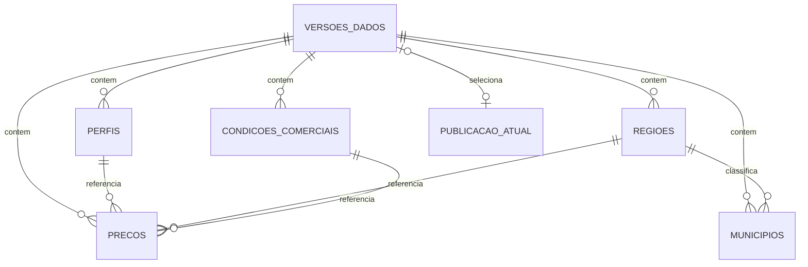

# Modelo físico PostgreSQL da v0.1

Data: 7 de outubro de 2026.  
Estado: escolhas técnicas adotadas sob a delegação do autor; esquema e migrações ainda não implementados.

## Objetivo e decisões

O autor pediu concluir a pendência do modelo físico após conferir a plausibilidade dos preços. Este documento fixa tabelas, colunas, chaves, índices, precisão decimal, publicação, imutabilidade, retenção e responsabilidades das migrações. Preserva os [requisitos](2026-10-04-requisitos-v0.1-design.md), a [arquitetura](2026-10-04-arquitetura-v0.1-design.md) e as [tecnologias adotadas](2026-10-06-tecnologias-e-implantacao.md).

Usar PostgreSQL 18.6, Drizzle ORM com `pg` e migrações SQL revisadas com Drizzle Kit, nas versões já registradas. O esquema SQL da aplicação será `mercado`. A preparação usará os [arquivos demonstrativos fixos](../../../data/demonstrativa/v0.1/manifesto.json), cuja escala de preços foi [conferida publicamente](2026-10-07-base-demonstrativa-v0.1.md#conferência-da-ordem-de-grandeza-dos-preços).

Adotar sete tabelas relacionais. Cada versão contém seus próprios cadastros e preços, inclusive quando os cadastros são iguais aos da versão anterior. A referência atual é uma única linha. Essa cópia limitada evita que corrigir um cadastro mude o significado de preços históricos já publicados. Guardar somente o manifesto de auditoria em `JSONB`; preços, pesos, vínculos e datas consultáveis terão colunas próprias.

Um único documento `JSONB` contendo toda a fotografia foi considerado: simplificaria a carga, mas exigiria validação adicional de referências e consultas dentro do documento. Cadastros globais mutáveis também foram considerados: economizariam poucas linhas, mas comprometeriam a interpretação das versões antigas. A estrutura relacional versionada aproveita a integridade do PostgreSQL e atende às duas consultas públicas sem particionamento ou materialização de indicadores.

## Tabelas e vínculos

Todas as colunas são `NOT NULL`, salvo as duas exceções explicitadas abaixo. Identificadores de versões, perfis, regiões e condições são `TEXT`, limitados por `CHECK` a 1–80 caracteres ASCII minúsculos, dígitos e hífens, começando e terminando com letra ou dígito. Preservar os identificadores dos arquivos, sem gerar identificadores numéricos substitutos. Os nomes de exibição permanecem em português, com acentos.

As tabelas de conteúdo terão FK de `versao_dados` para `versoes_dados`. Além disso, referências a perfis, regiões e condições serão sempre compostas com `versao_dados`, impedindo associação a um cadastro de outra fotografia. Usar `ON UPDATE NO ACTION` e `ON DELETE NO ACTION` em todas as FKs. Não apagar por cascata.

### `versoes_dados`

| Coluna | Tipo e regra |
| --- | --- |
| `versao_dados` | `TEXT`, PK; no primeiro conjunto, `go-reposicao-demo-2026-10-07-r1`. |
| `conjunto_id` | `TEXT`, identificador do conjunto de origem, com a mesma regra de tamanho; não é uma nova identidade da cotação. |
| `versao_formato_arquivos` | `TEXT`, valor `1` aceito nesta entrega; separado do futuro `schemaVersion` HTTP. |
| `natureza` | `TEXT`, `CHECK = 'demonstrativa'`. |
| `versao_territorial` | `TEXT`, referência da classificação; primeiro valor `imb-regplan-2018`. |
| `preparado_em` | `DATE`, finita; data informada pelo manifesto. |
| `janela_inicio`, `janela_fim` | `DATE`, finitas; 12 meses civis completos. |
| `primeira_semana`, `ultima_semana`, `semana_anterior` | `DATE`, finitas, às segundas-feiras; derivadas da janela. |
| `hash_conjunto_sha256` | `TEXT`, exatamente 64 caracteres hexadecimais minúsculos; SHA-256 dos bytes do arquivo `SHA256SUMS`, que referencia os seis arquivos. |
| `manifesto` | `JSONB`, objeto com o conteúdo do manifesto, para auditoria das fontes e premissas. |
| `estado` | `TEXT`, `preparacao` ou `publicada`; transição única dentro da transação. |
| `publicado_em` | `TIMESTAMPTZ(3)`, **anulável apenas em preparação**; finito quando preenchido e gerado pelo servidor. |

Não inferir identidade ou ordem pelo relógio. A PK identifica a versão; o resumo criptográfico confirma os arquivos usados. Mesmo identificador com conteúdo diferente é conflito, não atualização. Não definir unicidade pelo instante de publicação, pois publicações diferentes podem ter o mesmo milissegundo.

A janela começa no primeiro dia de um mês e termina no dia anterior à mesma data do ano seguinte. `primeira_semana` é a primeira segunda-feira dentro da janela; `ultima_semana`, a última; `semana_anterior = primeira_semana - 7`. Essas relações terão verificações SQL explícitas. O calendário pode ter 52 ou 53 segundas-feiras conforme os meses; o conjunto atual tem 52, mais a referência auxiliar. Não fixar 52 como regra geral do banco.

### `perfis`

| Coluna | Tipo e regra |
| --- | --- |
| `versao_dados`, `perfil_id` | `TEXT`, PK composta. |
| `ordem` | `SMALLINT`, de 1 a 8; única por versão. |
| `categoria` | `TEXT`: `Bezerro`, `Bezerra`, `Garrote` ou `Novilha`. |
| `sexo` | `TEXT`: `Macho` ou `Fêmea`. |
| `grupo_racial` | `TEXT`: `Nelore`, `Mestiço` ou `Mestiça`, com coerência por sexo. |
| `idade_referencia_meses` | `SMALLINT`, positiva. |
| `peso_referencia` | `NUMERIC(8,2)`, positivo e finito. |
| `unidade_peso` | `TEXT`, `CHECK = 'kg'`; peso vivo. |
| `referencia_parametros_id` | `TEXT`, identificador da referência no manifesto. |

Criar unicidade adicional de `(versao_dados, categoria, sexo, grupo_racial)`. `Bezerro` e `Garrote` exigem `Macho` com `Nelore` ou `Mestiço`; `Bezerra` e `Novilha` exigem `Fêmea` com `Nelore` ou `Mestiça`. O conjunto publicado contém as oito combinações aprovadas. Idade e peso estão no cadastro da versão, iguais para todas as suas regiões e semanas.

### `regioes`

| Coluna | Tipo e regra |
| --- | --- |
| `versao_dados`, `regiao_id` | `TEXT`, PK composta. |
| `ordem` | `SMALLINT`, de 1 a 10; única por versão. |
| `codigo_imb` | `TEXT`, valores `001` a `010`; único por versão. |
| `nome`, `nome_fonte_imb` | `TEXT`, não vazios, até 160 caracteres; exibição e grafia de origem. |
| `folha_fonte_imb` | `TEXT`, não vazio, até 80 caracteres; localização na planilha. |

A versão territorial é obtida de `versoes_dados`, sem outro cadastro territorial mutável. A preparação verifica os dez identificadores, nomes e códigos contra o arquivo fixo. O código IMB não será usado como código IBGE de município.

### `municipios`

| Coluna | Tipo e regra |
| --- | --- |
| `versao_dados`, `codigo_ibge` | PK composta; código `TEXT` com exatamente sete dígitos ASCII e prefixo `52`. |
| `regiao_id` | `TEXT`; FK `(versao_dados, regiao_id)` para `regioes`. |
| `nome`, `nome_fonte_imb` | `TEXT`, não vazios, até 160 caracteres. |
| `linha_fonte_imb` | `INTEGER`, positivo; linha da planilha, começando em 1. |

A PK impede que o mesmo município pertença a duas regiões na mesma versão. A conferência dos 246 códigos e nomes e da distribuição territorial usa o cadastro fixo, sem depender de uma consulta externa durante a publicação. A folha de origem é obtida da região, e a fonte e o resumo criptográfico da planilha, do manifesto.

### `condicoes_comerciais`

| Coluna | Tipo e regra |
| --- | --- |
| `versao_dados`, `condicoes_id` | `TEXT`, PK composta. |
| `pagamento` | `TEXT`, `CHECK = 'à vista'`. |
| `frete`, `tributos` | `TEXT`, `CHECK = 'excluído'` e `CHECK = 'excluídos'`, respectivamente. |
| `descricao` | `TEXT`, não vazia, até 512 caracteres. |

A v0.1 publica uma condição comum, `avista-sem-frete-sem-tributos`. As grafias persistidas são as do manifesto, sem tradução silenciosa. Cada preço referencia a condição da própria versão.

### `precos`

| Coluna | Tipo e regra |
| --- | --- |
| `versao_dados`, `perfil_id`, `semana`, `regiao_id` | PK composta nessa ordem. `semana` é `DATE` finita e segunda-feira. |
| `condicoes_id` | `TEXT`, referência às condições da mesma versão. |
| `preco` | `NUMERIC(12,2)`, positivo e finito; reais por cabeça. |
| `moeda` | `TEXT`, `CHECK = 'BRL'`. |
| `unidade_preco` | `TEXT`, `CHECK = 'cabeca'`. |
| `natureza` | `TEXT`, `CHECK = 'demonstrativa'`. |

Criar FKs compostas para `perfis`, `regioes` e `condicoes_comerciais`. O conjunto de origem é obtido de `versoes_dados.conjunto_id`; não repetir essa identidade em cada linha. A semana deve pertencer às referências da janela ou ser exatamente `semana_anterior`. Um gatilho confere esse vínculo temporal com a versão.

Ausência é ausência de linha. Não usar preço zero, valor nulo, indicador numérico de ausência ou linha preenchida por interpolação. Não persistir médias, percentuais nem preços por kg de peso vivo: são derivados das entradas daquela versão pelas regras do domínio.

### `publicacao_atual`

| Coluna | Tipo e regra |
| --- | --- |
| `id` | `SMALLINT`, PK, `CHECK = 1`; impede uma segunda referência. |
| `versao_dados` | `TEXT`, **anulável antes da primeira publicação**; FK para `versoes_dados`. |

A migração insere `(1, NULL)` sem substituir uma linha existente. A operação publicadora bloqueia essa linha; seu identificador nunca muda, e ela não pode ser removida ou truncada. Um gatilho só permite referência a uma versão em estado `publicada` e impede voltar a `NULL` depois da primeira publicação.

Fontes para os mecanismos relacionais: [restrições do PostgreSQL 18](https://www.postgresql.org/docs/18/ddl-constraints.html).

## Precisão e mapeamento para TypeScript

`NUMERIC(12,2)` admite até `9999999999.99` reais por cabeça; `NUMERIC(8,2)`, até `999999.99` kg. São capacidades técnicas do armazenamento, não limites de mercado ou pesos plausíveis. A conferência dos parâmetros e da receita permanece na preparação da base.

Preços e pesos terão `CHECK` de positividade e rejeição explícita de `NaN`, `Infinity` e `-Infinity`. Usar `NOT NULL`, pois uma verificação sozinha não rejeita valores nulos. A validação de entrada exige cadeias com exatamente duas casas e valores dentro da capacidade da coluna antes da inserção. O tipo `NUMERIC(p,2)` pode arredondar entrada com escala maior antes do `CHECK`; o banco não substitui essa validação lexical.

Drizzle manterá `numeric` em modo textual, `date` em modo textual e instantes em `timestamp` com fuso e precisão 3. O repositório serializará `publicado_em` para UTC com três casas e `Z`. As datas civis não passarão por objetos de instante com conversão de fuso. Converter valores monetários para `big.js` a partir das cadeias; não configurar conversores de `pg` que devolvam esses valores como `number`. SQL personalizado terá os mesmos mapeamentos.

Fontes: [tipos numéricos](https://www.postgresql.org/docs/18/datatype-numeric.html), [tipos temporais](https://www.postgresql.org/docs/18/datatype-datetime.html) e [tipos retornados por `pg`](https://node-postgres.com/features/types). A integração Drizzle já está fundamentada no registro tecnológico.

## Índices e consultas

| Índice | Consulta atendida |
| --- | --- |
| PK de `precos (versao_dados, perfil_id, semana, regiao_id)` | Histórico completo de um perfil, todas as regiões, pela janela e referência auxiliar. |
| B-tree `precos (versao_dados, semana, perfil_id, regiao_id)` | Resumo das duas últimas referências semanais para os oito perfis. |
| B-tree `municipios (versao_dados, regiao_id, codigo_ibge)` | Composição territorial e contagem por região. |
| PKs e restrições únicas dos cadastros | Referências e identificação dos registros da fotografia. |

Não criar índices isolados redundantes nem índices de texto, JSON, particionamento ou tabelas de indicadores para 4.146 preços por versão. A existência de um índice não garante sua escolha pelo planejador; medir as consultas reais com `EXPLAIN (ANALYZE, BUFFERS)` nos testes de desempenho antes de acrescentar índices.

O resumo lê a referência atual uma vez, junto aos metadados da versão publicada, e fixa esse identificador em todas as consultas daquela resposta. O histórico recebe a versão solicitada e também consulta apenas esse identificador. Usar parâmetros SQL, ordenação explícita por `ordem` dos cadastros e por `semana`, e projeções que excluam manifesto e listas municipais da resposta resumida. Os nomes das colunas internas não fixam ainda os esquemas HTTP.

Usar `READ COMMITTED`: a publicação é atômica, os conteúdos publicados são imutáveis e todas as versões são retidas. Portanto, ler uma referência antiga e depois suas tabelas continua produzindo uma fotografia completa, mesmo com publicação concorrente. Não reler o ponteiro entre consultas de uma resposta. A invalidade de um identificador solicitado recebe o tratamento de versão indisponível da arquitetura, sem trocar silenciosamente para a atual.

Fontes: [índices multicoluna](https://www.postgresql.org/docs/18/indexes-multicolumn.html) e [isolamento transacional](https://www.postgresql.org/docs/18/transaction-iso.html).

## Preparação e publicação atômica

Antes de abrir a transação, o comando de operações lê os arquivos fixos e valida SHA-256, manifesto, calendário, representação decimal, oito perfis, dez regiões, 246 municípios, condições, referências, unicidade, receita e conjunto exato de lacunas. O primeiro conjunto contém 4.146 preços; as contagens de outro conjunto devem corresponder ao seu próprio manifesto e receita, sem impor esse total a todas as versões futuras.

A publicação usa uma única conexão transacional de Drizzle, em `READ COMMITTED`, e segue esta ordem:

1. Bloquear `mercado.publicacao_atual` de `id = 1` com `SELECT ... FOR UPDATE`. Todas as operações publicadoras usam essa ordem de bloqueio.
2. No modo de preparação inicial, se já houver publicação compatível, encerrar sem sobrescrever a referência. A prontidão verifica compatibilidade; um ponteiro incompatível não autoriza substituição automática.
3. Verificar se o identificador já existe. Com o mesmo resumo criptográfico e estado publicado, devolver seus metadados sem mudar o ponteiro nem o instante. Com resumo diferente, rejeitar o conflito. Repetir uma versão antiga não a torna atual.
4. Inserir os metadados em `preparacao`, com `publicado_em = NULL`. Inserir cadastros, municípios e condições; depois, preços. Toda gravação permanece na mesma transação.
5. Solicitar a transição para `publicada`. O gatilho de finalização confere integridade e completude e atribui `clock_timestamp()` com precisão de milissegundos a `publicado_em`, sem aceitar um instante fornecido pelo comando.
6. Atualizar a referência atual para a nova versão já finalizada e confirmar a transação. Invalidar o resumo em memória somente após a confirmação. O mecanismo de leitura do ponteiro detecta a nova versão mesmo se o processo terminar antes dessa invalidação.

Falha em qualquer etapa desfaz metadados, conteúdo e troca da referência. A versão anterior permanece disponível. O instante representa a finalização realizada pelo servidor dentro da transação e não pretende ser o instante exato de confirmação do armazenamento. Não manter uma transação aberta enquanto consulta fontes externas ou gera preços.

Fontes: [transações no Drizzle](https://orm.drizzle.team/docs/transactions) e [bloqueios de linha](https://www.postgresql.org/docs/18/explicit-locking.html#LOCKING-ROWS).

## Imutabilidade e completude no banco

A proteção combina permissões e gatilhos SQL versionados nas migrações. Não depender apenas da disciplina do repositório TypeScript.

- Em `versoes_dados`, aceitar inserção somente em `preparacao`, com instante nulo. A única atualização permitida é a finalização; metadados, identificador e manifesto não podem ser alterados nessa atualização. Uma versão publicada rejeita qualquer atualização ou exclusão.
- Nas cinco tabelas de conteúdo, bloquear atualização e exclusão. Antes de inserir, consultar e bloquear a versão de origem com `FOR UPDATE`, exigindo estado `preparacao`. Isso também impede acrescentar preços ou municípios a uma versão já publicada. O gatilho de preços confere a semana contra os limites da versão.
- Na finalização, conferir os oito perfis, dez regiões, ordens completas, uma condição, total de municípios conforme o manifesto, ao menos um município por região e contagens de preços do manifesto. Conferir os campos normalizados contra o manifesto e a existência das referências de fontes no manifesto. A correspondência dos parâmetros e da composição territorial com os arquivos fixos é conferida pelo comando antes da carga. O comando também faz a comparação integral com a receita; restrições e gatilhos garantem integridade relacional e completude estrutural. Não declarar que contagens isoladas provam igualdade integral ao CSV.
- Criar um gatilho de restrição diferível, inicialmente adiado, para a inserção de `versoes_dados`: ao confirmar a transação, a versão inserida deve estar `publicada`. Consultar seu estado final pelo identificador, em vez de usar apenas a imagem `NEW` da inserção. Assim, uma transação encerrada antes da finalização não deixa preparação persistida.
- Bloquear `TRUNCATE` nas tabelas do esquema, inclusive versões e referência atual. Restringir inserção, exclusão e alterações do identificador da linha única; o publicador só atualiza sua coluna de versão.

O gatilho de finalização terá verificações SQL da estrutura e dos metadados. A comparação com arquivos e receita é responsabilidade do comando antes da carga; o banco não acessará o sistema de arquivos do projeto nem a internet. Os gatilhos usarão funções com permissões do chamador e nomes qualificados pelo esquema, sem necessidade de `SECURITY DEFINER`.

Fontes: [funções de gatilho](https://www.postgresql.org/docs/18/plpgsql-trigger.html) e [gatilhos, inclusive os diferíveis](https://www.postgresql.org/docs/18/sql-createtrigger.html).

## Permissões e retenção

| Papel de execução | Permissões necessárias |
| --- | --- |
| API de consulta | `USAGE` em `mercado` e `SELECT` nas sete tabelas; sem escrita, DDL ou alteração de gatilhos. |
| Publicador demonstrativo | `USAGE`, `SELECT`, `INSERT` nas tabelas de versão e conteúdo, `UPDATE` apenas das colunas de finalização da versão e da coluna de versão do ponteiro. Sem exclusão, truncamento, criação de objetos ou desativação de gatilhos. |
| Migrações | Credencial separada com propriedade ou privilégios necessários ao DDL e ao registro de migrações do Drizzle; não usada pela API nem pelo publicador. |

O `SELECT ... FOR UPDATE` exige permissão de atualização na tabela bloqueada. O publicador recebe atualização das colunas de finalização de `versoes_dados` e de `publicacao_atual.versao_dados`, suficiente para esses bloqueios; os gatilhos continuam restringindo as mudanças. API e publicador não serão proprietários das tabelas, superusuários ou membros do papel de migração.

A preparação de papéis e segredos ficará no ambiente de operações. Revogar criação pública no esquema e ajustar privilégios padrão do proprietário para que tabelas futuras não introduzam acesso de escrita na API. Credenciais não entram nas migrações nem nos arquivos de dados.

**Retenção adotada para v0.1/v0.2: conservar todas as versões publicadas, sem expiração nem limpeza automática.** O volume é pequeno e essa regra evita apagar uma fotografia usada por consulta em andamento, histórico solicitado ou estado salvo. Isso não muda a política de validade HTTP. A limitação de IndexedDB no navegador é uma decisão independente e não elimina versões do PostgreSQL.

Uma política futura de remoção precisará de requisitos e migração próprios, proteção da versão atual e coordenação com leitores. O contrato de versão indisponível permanece previsto, mas esta entrega não o provocará por expiração automática. Não introduzir um serviço de retenção ou uma credencial de exclusão agora.

Fontes: [privilégios](https://www.postgresql.org/docs/18/ddl-priv.html) e [permissões de seleção e bloqueio](https://www.postgresql.org/docs/18/sql-select.html).

## Organização e migrações

| Local planejado | Responsabilidade |
| --- | --- |
| `apps/api/src/db/schema.ts` | Declarações Drizzle das sete tabelas, colunas, chaves, verificações e índices. |
| `apps/api/src/db/repository.ts` | Leituras parametrizadas com versão fixada e mapeamento textual de valores. |
| `apps/api/src/db/publication.ts` | Transação de publicação, idempotência e conflito de identidade. |
| `apps/api/src/demo/` | Leitura, conferência e preparação dos arquivos fixos; comandos separados da API pública. |
| `apps/api/drizzle/` | SQL e metadados das migrações geradas e personalizadas revisadas. |

A primeira sequência de migrações criará esquema, tabelas, restrições, índices e linha única; depois introduzirá funções e gatilhos e aplicará as concessões aos papéis previamente preparados. Essas etapas estarão concluídas antes de qualquer carga ou consulta. O manifesto, a receita e os preços ficam na preparação demonstrativa, sem carregar milhares de linhas dentro de uma migração estrutural.

Gerar alterações declarativas com Drizzle Kit; escrever funções, gatilhos e concessões em migrações SQL personalizadas versionadas. Manter também os metadados exigidos pelo Kit, conferir o SQL e aplicar o histórico pelo mecanismo de migração adotado. Nunca editar uma migração já aplicada nem usar sincronização direta do esquema como fluxo acadêmico.

A configuração completa dos comandos, segredos e ambiente continua na pendência correspondente. Estes caminhos e a sequência fixam a responsabilidade das migrações; não são arquivos ou comandos já disponíveis.

Fontes: [migrações Drizzle](https://orm.drizzle.team/docs/migrations) e [migrações personalizadas](https://orm.drizzle.team/docs/drizzle-kit-generate#custom-migrations).

## Verificação exigida na implementação

Seguir TDD com PostgreSQL real da imagem fixada, usando Testcontainers. Nenhuma migração executável ou teste de banco foi introduzido nesta definição. Os testes deverão demonstrar:

1. Aplicação numa base vazia, reaplicação sem duplicar a linha única e evolução com nova migração, preservando versões publicadas.
2. Carga exata do conjunto: oito perfis, dez regiões, 246 municípios e 4.146 preços; recuperação textual de preço e peso e preservação das datas civis.
3. Rejeição de duplicatas, referências de outra versão, moeda/unidade/natureza inválidas, nulos, zero, negativos, valores não finitos, datas não semanais e preços fora da janela. Rejeição lexical de escala excessiva antes da inserção, separada do teste das restrições SQL.
4. Publicação com duas conexões independentes, falha após carga parcial, ponteiro anterior preservado e rejeição de confirmação antes da finalização. Repetição com mesmo identificador e resumo mantém instante e ponteiro; conteúdo divergente é conflito.
5. Tentativas de inserir, atualizar, excluir e truncar conteúdo publicado com os papéis reais; rejeição de modificação do manifesto, dos pesos e do instante. API consegue consultar e falha ao escrever.
6. Resumo e histórico consistentes durante publicação concorrente, recuperação de versão antiga após novas publicações e cumprimento dos cenários CA03–CA08 da base.
7. Planos e tempos das consultas reais; orçamentos HTTP e persistência do navegador continuam sendo medidos nas camadas correspondentes.

A pendência do desenho físico fica resolvida por este registro. A construção do esquema, das migrações, das operações e dos testes integra o futuro plano de implementação, junto à formalização dos contratos e do ambiente.
